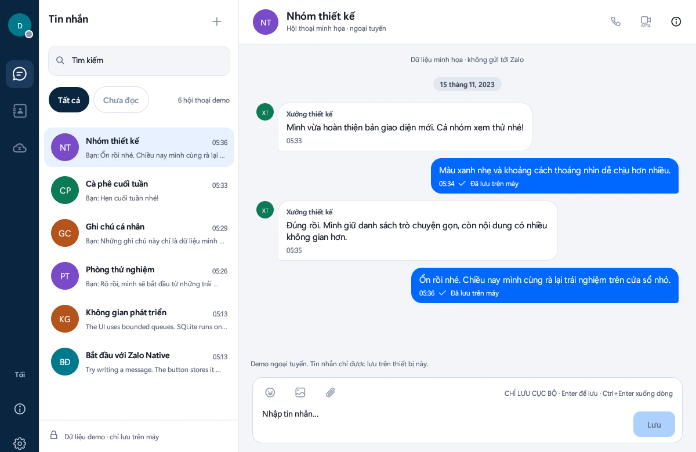

# v2.0.0 — Zalo Native: giao diện mới, chế độ Sáng/Tối và gói cài đặt `.deb`/`.rpm`

Bản đầu tiên của ứng dụng **Zalo Native** (Rust, giao diện `egui`, không dùng Electron) được đóng gói để cài bằng `apt`, `dnf` hoặc `yum`. Đây là bản thử nghiệm: dự án cộng đồng, không thuộc Zalo hay VNG.



> Ảnh giả lập từ chế độ `--demo`: hội thoại tự tạo, không có tài khoản hay tin nhắn thật.

## Có gì mới

- **Giao diện thiết kế lại**, có chế độ **Sáng** và **Tối**. Nút Sáng/Tối ở thanh bên đổi nhanh; Hệ thống và Tùy chỉnh vẫn chọn trong Cài đặt. Lựa chọn được lưu theo hồ sơ.
- **Danh sách hội thoại gọn hơn:** tiêu đề, ô tìm kiếm lớn, chip lọc, hàng hội thoại rộng rãi; bong bóng tin nhắn bo góc, tin của bạn nền xanh chữ trắng.
- **Danh bạ, thông tin hội thoại, cài đặt và đăng nhập QR** cùng ngôn ngữ thiết kế; cửa sổ nhỏ (640×480) vẫn dùng được.
- **Cài bằng gói:** `zalo-native_2.0.0-1_amd64.deb` và `zalo-native-2.0.0-1.x86_64.rpm`. Gói độc lập với gói Electron `zalo`, cài cùng lúc được.

## ⚠️ Thay đổi phím gửi tin

| Phím | Trước | Từ 2.0.0 |
| --- | --- | --- |
| `Enter` | xuống dòng | **gửi tin** |
| `Ctrl+Enter` (hoặc `Shift+Enter`) | gửi tin | **xuống dòng** |

`Enter` không chèn dòng mới. Ứng dụng không gửi khi bộ gõ tiếng Việt (Telex/VNI…) đang soạn chữ, ngay khung vừa xác nhận chữ, hoặc khi giữ phím.

## Cài đặt

Tải gói tương ứng ở mục *Assets* của bản phát hành rồi cài từ thư mục chứa tệp:

```bash
# Ubuntu / Debian
sudo apt install ./zalo-native_2.0.0-1_amd64.deb

# Fedora / RHEL / AlmaLinux / Rocky   (yum dùng cùng lệnh)
sudo dnf install ./zalo-native-2.0.0-1.x86_64.rpm
```

Mở **Zalo Native** từ menu ứng dụng, hoặc chạy `zalo-native --live` (đăng nhập QR) / `zalo-native --demo` (dùng thử, không cần tài khoản). Gỡ cài đặt: `sudo apt remove zalo-native` hoặc `sudo dnf remove zalo-native`. Dữ liệu người dùng nằm ở hồ sơ trong thư mục XDG của bạn và không bị gỡ cùng gói.

Yêu cầu: x86_64, glibc 2.31 trở lên, môi trường desktop với OpenGL. Chưa có kho `apt`/`dnf` để tự cập nhật; muốn nâng cấp hãy cài gói mới hơn theo cùng lệnh.

### Nếu menu vẫn mở bản cũ hoặc mất icon

Đã từng cài Zalo Native bằng `scripts/rust/install-desktop.py` (cài riêng cho một người dùng)? Mục menu đó cùng ID với mục của gói và **được ưu tiên hơn**, nên menu vẫn chạy binary cũ. Gỡ bản cũ rồi làm mới cache icon:

```bash
rm -f ~/.local/share/applications/zalo-linux-rust-preview.desktop \
      ~/.local/share/icons/hicolor/*/apps/zalo-linux-rust-preview.png
rm -rf ~/.local/share/zalo-linux-rust-preview
gtk-update-icon-cache -f -t ~/.local/share/icons/hicolor
```

Hồ sơ và tin nhắn nằm ở `~/.local/share/zalo-rust/` nên không bị xóa. Sau đó đăng xuất/đăng nhập lại (hoặc khởi động lại shell) để GNOME bỏ shortcut và icon đã cache.

### Mã băm SHA-256

```
de46038ef6aa72de4da9af7639be747effba0e5427db2deb4dd3f89c79144a1c  zalo-native_2.0.0-1_amd64.deb
7426b536e760ce84ca50da88867a39f59176d8d5964c207d4819015ce5939281  zalo-native-2.0.0-1.x86_64.rpm
```

## Đã kiểm chứng

- Cài, chạy `zalo-native --version` và `--doctor`, rồi gỡ sạch bằng trình quản lý gói trong container sạch trên **Ubuntu 20.04, 22.04, 24.04, Debian 12** (`.deb`) và **Fedora 42, AlmaLinux 9** (`.rpm`, kèm `rpm -V`).
- Bộ kiểm thử Rust (477 kiểm thử với mọi tính năng), Clippy không cảnh báo, kiểm thử độ tương phản chữ/nền ở cả hai chế độ, và kiểm thử phím `Enter`/`Ctrl+Enter` cùng các rào bộ gõ.
- Ảnh giao diện chụp từ chính cửa sổ ứng dụng ở 1200×780 và 640×480, cả hai chế độ; ứng dụng cũng hiển thị đúng trên Wayland thuần.

## Giới hạn đã biết

- **Chưa kiểm với tài khoản thật** và **chưa kiểm bộ gõ trên Wayland native**; mọi bằng chứng trên là dữ liệu giả lập, trong container hoặc cửa sổ demo. Hãy báo lỗi nếu gặp.
- Chip **Chưa đọc** đang tắt và chưa có huy hiệu số tin chưa đọc (dữ liệu hội thoại chưa lưu trạng thái này).
- Chưa hỗ trợ gọi thoại/video, gửi ảnh/tệp, đăng nhập bằng số điện thoại; xem [bảng đối chiếu tính năng](../rust-client/FEATURE_PARITY.md).
- Gói chỉ có kiến trúc x86_64; Debian 11 chưa được kiểm vì kho apt của bản đã hết hạn.
- Ứng dụng đi kèm phông và biểu tượng Zalo gốc của VNG Corp.; gói không cấp giấy phép cho các tài nguyên đó.

Chi tiết kỹ thuật: [CHANGELOG](../rust-client/CHANGELOG.md) · [hướng dẫn thiết kế](../rust-client/UI_REDESIGN_GUIDE.md).
